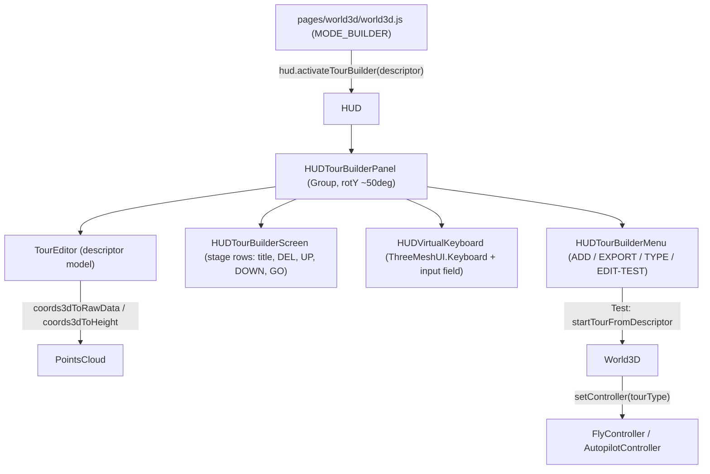

# HUD Tour Builder panel (MODE_BUILDER)

## Architecture

## 1. Data model: `TourEditor`

New file `js/modules/3d/hud/tour-editor.js` (pure logic, no rendering):

- Holds the full descriptor (deep copy of the JSON loaded via `dataStore.getTourDescriptorFile(sceneParams.tour)`), so that `desc`, `audiofile`, `filters`, `lang`, `voice_level`, etc. are preserved when exported.
- When the scene has no Tour, use the default descriptor `{version: "0.3.0", type: "guided_tour", title: sceneParams.name, lang: "en", coords_type: "data_series", stages: []}`.
- Methods: `addStage(title, world3dPos)`, `removeStage(i)`, `moveUp(i)`, `moveDown(i)`, `setType(type)`, `getWorld3dPosition(i)`, `toJSON()`.
- Stage coordinates are stored in descriptor units. Existing stages are therefore exported unchanged, and only new stages are converted from the 3D position.
- If the descriptor has no `initial_pos` (required by `guided_tour`), `toJSON()` uses the coords of the first stage.

## 2. Inverse coordinate conversion in [js/modules/3d/points-cloud.js](js/modules/3d/points-cloud.js)

- `coords3dToRawData([x,y,z])`: inverse of `dataToCoords3d` (division by `getHomothetyFactors()` plus `min*`, then `10**v` when the axis uses `SCALE_LOG`), rounded to integers like the existing files.
- `coords3dToHeight([x,y,z])`: returns the `key` of the nearest `dataPoint`, for tours with `coords_type: "block_height"` such as `borealis_1.json`.

## 3. HUD panel (same look and feel as the existing screens)

- `js/modules/3d/hud/hud-tour-builder-screen.js` (extends `ThreeMeshUI.Block`): it reuses the styles of [hud-left-screen.js](js/modules/3d/hud/hud-left-screen.js), namely the `0x10faef` font, the semi-transparent black background (`0.5`) and the `0x044b4f` border.
  - It uses a fixed pool of N rows (around 8), plus page-up and page-down arrows in the footer. This is needed because `WebXRManager.makeInteractive` has no way to unregister objects, so the widgets are created once and only their content and visibility change.
  - Each row shows the stage `title` and the buttons `[X]` (delete), `[UP]`, `[DN]` and `[GO]`, which teleports via `camera.moveTo(pos, currentRotation)`.
  - In Test mode, the edit buttons are greyed out and inactive.
- `js/modules/3d/hud/hud-tour-builder-menu.js`: a button bar modelled on [hud-right-menu.js](js/modules/3d/hud/hud-right-menu.js), with the same states (`hovered`, `pressed`, `idle`) and the same haptic feedback. It has four buttons:
  - `[ + ]` adds a stage.
  - `[ EXPORT ]` exports the JSON.
  - `[ TYPE: xxx ]` cycles through `guided_tour`, `guided_tour_autopilot` and `autopilot`. It is disabled in Test mode.
  - `[ EDIT ]`/`[ TEST ]` switches between the two modes.
- `js/modules/3d/hud/hud-tour-builder-panel.js` (a `Group`) assembles the screen and the menu. In [hud.js](js/modules/3d/hud/hud.js), the panel is instantiated like `leftScreen` and placed for example at `x=-0.42, y=0.85, z=-0.30`, using `rotateY(+50deg)` and then `rotateOnAxis(X, -PI/3)` on the screen and `-PI/9` on the menu, to match the existing screens. It is hidden by default (`visible = false`), shown by `hud.activateTourBuilder(...)`, and wired into `update()` and `dispose()`.

## 4. Virtual keyboard

- `js/modules/3d/hud/hud-virtual-keyboard.js` combines `ThreeMeshUI.Keyboard` (already exported by the lib, which ships the `backspace.png`, `enter.png` and `shift.png` textures) with a text field that shows what is being typed. It is created once, placed in front of the user and hidden by default.
- Each key goes through `makeInteractive`. `enter` validates the input, and an extra `[ CANCEL ]` key closes the keyboard.
- `open(callback)` and `close()`: when the user clicks `[ + ]`, the current position of `camera.parent` is captured **at click time**, and `TourEditor.addStage(title, pos)` is called once the input is validated.

## 5. Export (Blob download)

In the menu, `[ EXPORT ]` builds a `Blob` from `JSON.stringify(descriptor, null, 2)` and triggers a download through a temporary `<a download>` link. The file is named after the source tour (for example `bitcoin_tsunami_1.json`), or `tour_<sceneName>.json` for a new tour. A confirmation message is shown on `leftScreen.displayMessage`.

## 6. Edition and Test modes: changes to [js/modules/3d/world3d.js](js/modules/3d/world3d.js)

- `setController(tourType)` disposes the current controller and instantiates `AutopilotController` (for `autopilot` and `guided_tour_autopilot`) or `FlyController`. The logic is extracted from `#initController`.
- `startTourFromDescriptor(descriptor)` sets `tourType`, lazily creates `audioguide` if it is missing, calls `setController`, `initTour()` and `tour.loadDescriptor(descriptor)`, then `loadPath` and `start()`.
- `stopTour()` removes the controller listeners (the same code as `dispose()`), removes and disposes the tour, stops the audioguide, calls `pointsCloud.filterPointsCloud(null)`, reactivates `selectionHelper`, and calls `setController(null)` to go back to Fly.
- In [guided-tour.js](js/modules/3d/guided-tour.js), [guided-tour-autopilot.js](js/modules/3d/guided-tour-autopilot.js) and [autopilot.js](js/modules/3d/autopilot.js), `load(url)` is split into `load(url)` and `loadDescriptor(descriptor)` with no change in behaviour. `exit()` calls `this.world3d.onTourExit()`, which defaults to `xrManager.endSession()`. In builder mode it is overridden so that the panel returns to Edition mode instead of leaving the immersion.
- **Test**: teleport to `initial_pos`, converted with `getWorld3dPosition`, or to the first stage if there is none, then `startTourFromDescriptor(tourEditor.toJSON())`.
- **Edition**: `stopTour()`. The user stays at their current position.

## 7. Integration in [pages/world3d/world3d.js](pages/world3d/world3d.js)

In MODE_BUILDER:

- Build `World3D` with `tourType = null`, so the user starts in Fly mode for editing.
- Stop calling `initTour()` and `startTour()` automatically.
- Load the descriptor if `sceneParams.tour` is set, then call `world3d.hud.activateTourBuilder(descriptor, sceneParams)`.

MODE_EXPLORER is unchanged.

## Points to watch

- Some browsers in a headset may queue or pause the download during the WebXR session, so the export needs to be tested on a Quest.
- New stages only contain `coords` and `title`. The `desc`, `audiofile` and `filters` fields of existing stages are preserved.