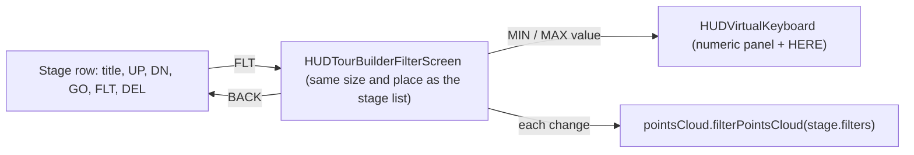

# Per-stage block filters in the Tour Builder

## Data format (unchanged)

`stage.filters = [[["x", min, max], ["y", min, max]], [["key", min, max]]]`. The outer list holds groups combined with OR, and each group holds conditions combined with AND. Bounds are raw values. `#isPointHidden` already applies log10 on log-scale axes. The supported attributes are `x`, `y`, `z` and `key` (block height). `ts` is left out because a raw timestamp is too hard to type in VR.

## UI

- **Stage row** ([hud-tour-builder-screen.js](js/modules/3d/hud/hud-tour-builder-screen.js)): add a `FLT` button before `DEL`. Its label is `FLT` when the stage has no filters and `FLT n` when it has `n` groups. Shrink the title block to `width - 5 * 0.036`. The button is disabled in Test mode, like the other edit buttons.
- **Filter screen**: new file `js/modules/3d/hud/hud-tour-builder-filter-screen.js`. It extends `ThreeMeshUI.Block` with the same style as the stage screen (font `0x10faef`, black background at 0.5, border `0x044b4f`) and builds its rows once with `createHudButton`. It occupies the same position and rotation as the stage screen, and the panel toggles between the two with `visible`. The existing `#syncLayers` already removes hidden widgets from raycasting.
  - Header: `FILTERS : <stage title>` (clipped).
  - It has 8 paginated rows. Groups and conditions are flattened into one list, so each row is one of two kinds:
    - Group row: label `GROUP 1`, then `OR GROUP 2`, and so on, with buttons `[+ RANGE]` and `[DEL]`.
    - Condition row: `[X|Y|Z|HEIGHT]` (cycles the attribute and resets the bounds to the full range of that attribute), `[min]` `-` `[max]` (value buttons that open the keyboard), and `[DEL]`.
  - Footer: the `<` and `>` page arrows with the page number, then `[ADD GROUP]`, `[GO]` (teleports to the stage to preview the filter from its viewpoint) and `[BACK]`.
- **Live preview**: on opening the screen and after every change, call `world3d.pointsCloud.filterPointsCloud(stage.filters)`. `BACK` calls `filterPointsCloud(null)`. The filtering job is already incremental.

## Keyboard ([hud-virtual-keyboard.js](js/modules/3d/hud/hud-virtual-keyboard.js))

- Generalise the signature to `open(callback, { placeholder = 'STAGE TITLE', initialText = '', numeric = false, onHere = null })`. The current `addStage` call keeps working unchanged.
- In numeric mode, switch to the `.?12` panel with `keyboard.setNextPanel()` and prefill the current value. On `enter`, `Number(text)` is passed to the callback only if it is finite. Otherwise show the message "Invalid number" via `hud.leftScreen.displayMessage`, which the panel handles.
- Add a `[HERE]` button next to `CANCEL`, visible only when `onHere` is set. It replaces the text with `onHere()`, which is the raw value of the user's position on the condition's attribute. Its layer follows the same rule as `CANCEL` in `syncLayers`.

## Model ([tour-editor.js](js/modules/3d/hud/tour-editor.js))

- `addFilterGroup(stageIndex, condition)`, `removeFilterGroup(stageIndex, g)`, `addFilterCondition(stageIndex, g, condition)`, `removeFilterCondition(stageIndex, g, c)` and `setFilterCondition(stageIndex, g, c, [attr, min, max])`.
- Removing the last condition of a group removes the group. Removing the last group deletes `stage.filters`, so the exported JSON stays clean.
- `toJSON()` strips empty groups as a safety net. An empty group would match every block.

## Panel ([hud-tour-builder-panel.js](js/modules/3d/hud/hud-tour-builder-panel.js))

- `openFilters(index)` and `closeFilters()` swap the stage screen and the filter screen and handle the preview.
- `#enterTest()` calls `closeFilters()` first, because the tour then applies stage filters itself.
- `defaultCondition(attr)` uses the full range of the data: `cloudData.minX` and `maxX` (with `10 ** v` on log axes) for `x`, `y` and `z`, and `minH` and `maxH` for `key`. A new condition therefore hides nothing at first.
- `positionValue(attr)` uses `coords3dToRawData(camera.parent.position)[axis]` for `x`, `y` and `z`, and `coords3dToHeight(...)` for `key`. The result is rounded to an integer when its absolute value is 1 or more.
- `editFilterBound(stageIndex, g, c, which)` opens the numeric keyboard and then calls `setFilterCondition`, refreshes the filter screen and updates the preview.
- Instantiate the filter screen in the constructor with the same transform as `this.screen`, and dispose of it in `dispose()`.

## Value display

Use a compact formatter for the value buttons: integers as they are, otherwise up to 4 significant digits, and a `k`/`M` suffix above 10 000 so the text fits in about 0.075 m. The keyboard prefill shows the full value.
